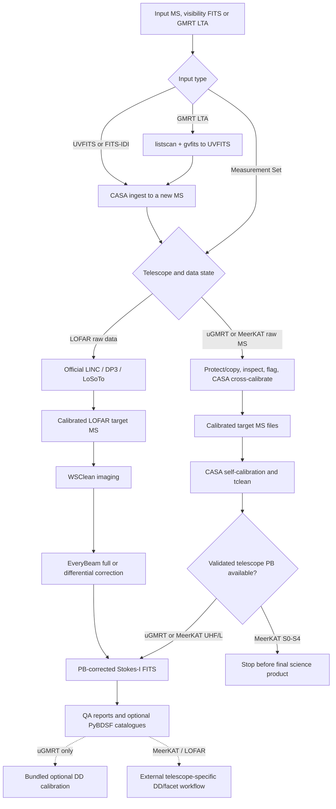

# uGMRT, MeerKAT, and LOFAR Radio Continuum Pipeline

This telescope-aware pipeline accepts a CASA Measurement Set (MS), a
visibility FITS file or a GMRT LTA file, then reduces Stokes-I radio-continuum
data from uGMRT and MeerKAT and images calibrated LOFAR target MSs. Visibility
FITS and LTA are imported to a new MS before inspection; an MS follows the
existing path unchanged. The
pipeline identifies the telescope before resolving the receiver band, records
the instrument and backend in every report, and refuses unsupported
combinations instead of silently applying another telescope's calibration or
beam model.

The three instruments do not share one universal recipe. The implemented
paths are deliberately different, and their publication-readiness status is
defined in [SCIENCE_VALIDATION.md](SCIENCE_VALIDATION.md):

| Telescope and input | Flagging and cross-calibration | Self-calibration | Final imaging and primary beam | Bundled DD calibration |
|---|---|---|---|---|
| uGMRT B2/B3/B4/B5 raw MS, visibility FITS or LTA | Guarded two-round CASA path; B4 and B5 run on real data, B2 and B3 pending | CASA, or the WSClean per-target chain (`run_targets.py`) | CASA `tclean` plus the measured 2023 uGMRT polynomial PB model | Peeling of bright off-axis sources in `run_targets.py`; optional experimental uGMRT killMS/DDFacet recipe |
| MeerKAT UHF/L raw MS or visibility FITS | CASA Stokes-I; MeerKAT masks and guarded corrected-data flag/re-solve; UHF requires an explicit validated broadband model, while L uses a validated built-in or explicit model | CASA, or the WSClean per-target chain (`run_targets.py`) | WSClean (default) with the `katbeam` UHF/L beam applied to its output; CASA `tclean` with `--imager casa` | Peeling of bright off-axis sources in `run_targets.py`; no facet calibration |
| MeerKAT S0/S1/S2/S3/S4 raw MS or visibility FITS | CASA cross-calibration and QA are available; the tuning must be explicit when frequency coverage is ambiguous | CASA, or the WSClean per-target chain with `--no-primary-beam` | No validated bundled S-band PB model; publication imaging and PB-selected cataloguing fail closed | Peeling in `run_targets.py` |
| LOFAR LBA/HBA raw data | Not accepted; calibrate upstream with LINC/DP3/LoSoTo | Not in this pipeline | Not applicable until an upstream calibrated target MS exists | No |
| LOFAR LBA/HBA calibrated target MS | Upstream result is inspected, not recalibrated | Use a LOFAR-specific DP3/LoSoTo or facet workflow | WSClean with EveryBeam; the beam state must be explicit | No; use a LOFAR facet/DD workflow |

Here, “visibility FITS” means interferometric visibilities stored as
random-groups UVFITS or as a FITS-IDI `UV_DATA` binary table. It does **not**
mean a restored, dirty, model, residual, primary-beam, or catalogue image in a
FITS file. Image FITS contains sky pixels rather than the antenna-baseline,
time, frequency, and correlation samples needed for calibration and is
rejected at input.

The implemented scope is continuum Stokes I. This is not a polarization-
calibration pipeline. Passing the automated tests establishes control-flow
and fail-closed behavior, not telescope science certification. Each band stays
not-publication-ready until the real reference-data gates in
`SCIENCE_VALIDATION.md` have passed for the exact software versions in use.
Deep LOFAR wide-field reductions and international-baseline data normally need
a telescope-specific direction-dependent/facet workflow.

MeerKAT's CASA calibration choices follow the processMeerKAT
[cross-calibration guidance](https://idia-pipelines.github.io/docs/processMeerKAT/cross-calibration-in-processmeerkat/),
and its UHF/L imaging uses a measured `katbeam` model because the
[processMeerKAT imaging guidance](https://idia-pipelines.github.io/docs/processMeerKAT/science-imaging-in-processmeerkat/)
warns against CASA's standard PB products for MeerKAT. Raw LOFAR preprocessing
and calibration remain with the official
[LINC workflow](https://linc.readthedocs.io/en/stable/); this pipeline uses
WSClean's documented
[EveryBeam primary-beam correction](https://wsclean.readthedocs.io/en/v3.4/primary_beam_correction.html)
on the resulting target MS.

## Shared architecture and entry points

There is one science pipeline, with four ways to start it:

| Entry point | Use it for | Instrument behavior |
|---|---|---|
| `run_ugmrt.py` | An explicitly uGMRT run | Pins `--telescope ugmrt` and `--imager casa` (uGMRT is always imaged with tclean) |
| `run_meerkat.py` | An explicitly MeerKAT run | Pins `--telescope meerkat`; images with WSClean unless `--imager casa` |
| `run_lofar.py` | A calibrated LOFAR target MS | Pins `--telescope lofar` and defaults to calibrated input plus WSClean |
| `pipeline.py` | One generic or metadata-selected command | Uses `telescope` from the CLI/config, including `auto` detection |

The three `run_*.py` files are deliberately thin launchers. They all load the
same argument parser and configuration, then hand execution to `pipeline.py`:

```text
config.yaml ──> config.py ──> pipeline.py ──> telescope-supported stage scripts
                                ▲
run_ugmrt.py ───────────────────┤
run_meerkat.py ─────────────────┤
run_lofar.py ───────────────────┘
```

Calibration, flagging, resume validation, imaging, and report logic are not
copied into the launchers. Edit `config.yaml` for normal run-specific
overrides; `config.py` supplies the complete defaults and telescope profiles.
CLI values override the shared config for one run. A named launcher overrides
the configured telescope and rejects a conflicting explicit `--telescope`.

For a fully config-driven run, set `ms` to the input MS or visibility FITS,
set `telescope` (or `auto`) and `outdir`, then run `python3 pipeline.py`. For
FITS, also set `fits_format` and optionally `imported_ms`. The named launchers
are the more explicit option when scripts or batch jobs are dedicated to one
instrument.

## Quick starts

First use `--dry-run`, then omit it after checking the selected telescope,
band, fields, backend, and beam policy.

uGMRT raw continuum data:

```bash
python3 run_ugmrt.py /data/raw/ugmrt_observation.ms \
  --outdir /scratch/products/ugmrt_observation \
  --copy-input-ms \
  --dry-run
```

The equivalent UVFITS start is:

```bash
python3 run_ugmrt.py /data/raw/ugmrt_observation.uvfits \
  --fits-format auto \
  --outdir /scratch/products/ugmrt_observation \
  --dry-run
```

The FITS file is read-only input. The pipeline imports it to
`<outdir>/ingest/ugmrt_observation.ms`, so `--copy-input-ms` is neither needed
nor useful for this path. Use `--imported-ms /scratch/ugmrt_working.ms` to
choose a different converted-MS destination.

The equivalent start from a GMRT LTA file, as the GMRT Online Archive
delivers it:

```bash
python3 run_ugmrt.py /data/raw/28_066_22NOV2020_gwb.lta \
  --listscan /software/gmrt/listscan \
  --gvfits /software/gmrt/gvfits \
  --outdir /scratch/products/ugmrt_observation \
  --dry-run
```

`listscan` and `gvfits` are NCRA's converters, not part of CASA; Linux builds
of both are in [CAPTURE-CASA6](https://github.com/ruta-k/CAPTURE-CASA6). Make
them executable (`chmod +x`). Each option also takes a whole command, for
example one that runs the program in a container (use absolute paths). The
ingest stage converts the file to UVFITS in `<outdir>/ingest/lta/`, keeps the
listscan log and both programs' output there, imports the FITS with
`importgmrt`, and then removes the FITS, which is as large as the data
(`--keep-lta-fits` keeps it). The LTA file is never written to; its checksum
binds the imported MS on resume, as a FITS file's does. `lta_convert.py
IN.lta OUT.FITS` converts a file on its own.

MeerKAT L-band raw data (replace the example field names with those reported
by inspection):

```bash
python3 run_meerkat.py /data/raw/meerkat_observation.ms \
  --receiver-band L \
  --flux-calibrator J1939-6342 \
  --bandpass-calibrator J1939-6342 \
  --phase-calibrator PHASE_CAL \
  --target-fields TARGET_A,TARGET_B \
  --target TARGET_A \
  --outdir /scratch/products/meerkat_observation \
  --copy-input-ms \
  --dry-run
```

For MeerKAT visibility FITS, replace the positional MS with the `.uvfits` or
`.fits` file and omit `--copy-input-ms`. The field and model options remain the
same. A generic `.fits` suffix is classified from its headers; use
`--fits-format uvfits` or `--fits-format fitsidi` when you want the expected
visibility convention to be explicit.

For MeerKAT UHF, also pass a validated absolute-flux CASA image or component
list, for example `--flux-model /path/to/model --flux-model-type casa-image`.
The model is predicted with CASA `ft`; its contents, not just its pathname,
are SHA-256-bound to calibration and resume provenance. If calibration creates
several target MSs, the default `--target-selection auto` policy chooses one
using validated post-flagging statistics: it maximizes usable visibility count,
then minimizes flagged fraction, then uses the target name as a deterministic
tie-break. The decision and complete ranking are written to
`<outdir>/target_selection.json`. Pass `--target TARGET_A` to override the
choice; this does not invalidate shared cross-calibration products. Use a
separate output directory for each target once target-dependent products have
been completed.

LOFAR HBA after LINC has produced a materialized, CASA-readable target MS:

```bash
python3 run_lofar.py /data/calibrated/linc_target.ms \
  --receiver-band HBA \
  --wsclean-data-column CORRECTED_DATA \
  --lofar-beam-mode full \
  --target TARGET \
  --outdir /scratch/products/lofar_target \
  --no-copy-input-ms \
  --dry-run
```

`run_lofar.py` supplies `--data-state calibrated --imager wsclean` when those
options are omitted. This is a convenience default, not a raw-LOFAR
calibration implementation: raw LOFAR data must first pass through LINC/DP3,
and the launcher still requires an explicit/configured `--lofar-beam-mode`
before science imaging.

Choose `full` only when WSClean should derive and apply the full station beam
from trustworthy MS metadata. Choose `differential` only as an expert override
when the upstream visibilities are already phase-centre beam corrected; choose
`none` to make an explicitly uncorrected QA image. The `none` mode cannot feed
a PB-required science catalogue.

Importing raw LOFAR visibility FITS does not make the uGMRT/MeerKAT CASA
calibration recipe valid for LOFAR. Raw LOFAR processing still belongs in
LINC/DP3/LoSoTo, and the supported LOFAR start remains the materialized,
calibrated target MS produced by that workflow. Keeping that MS also preserves
the telescope metadata needed for trustworthy EveryBeam correction.

## Input MS versus visibility FITS (and GMRT LTA)

An MS is a directory containing the raw interferometric measurements from the telescope. It contains visibilities rather than a sky image. The pipeline converts those measurements into an image of the radio sky.

Visibility FITS stores the same broad class of interferometric samples in a
FITS interchange convention. The accepted conventions are:

- random-groups UVFITS, normally named `.uvfits` or `.fits`;
- FITS-IDI with a `UV_DATA` binary-table extension, normally named `.fits`.

With `--fits-format auto` (the default), every existing FITS input is
classified from its headers, regardless of filename. Files named `.uvfits`
normally contain random-groups UVFITS, while generic `.fits`, `.fit`, or
`.fts` names can contain either supported convention. The pipeline fails
closed if the headers describe an image or do not unambiguously identify
visibility data. An explicit format is an assertion that is still validated;
it cannot force an image FITS through the visibility importer.

A GMRT LTA file is the GMRT's own raw format and has no FITS header. It is
recognised by its name (`.lta`; `.ltb`, the GSB lower sideband; `.lta_1` and
so on, parts of a split recording) or by `--fits-format lta`, converted to
random-groups UVFITS with NCRA's `listscan` and `gvfits`, and that FITS is
then checked and imported like any uGMRT UVFITS. Legacy GSB dual-frequency
recordings are not handled; convert them by hand one polarisation at a time.

FITS ingestion uses CASA `importgmrt` for uGMRT UVFITS, `importuvfits` for
other UVFITS, and `importfitsidi` for FITS-IDI. It creates a new, mutable MS and
records the input path, size, modification time, checksum, detected format,
telescope, CASA task, and imported-MS path in `ingest/ingest_report.json`. The
`ingest/ingest.done` marker is written only after the resulting MS validates.
CASA documents the telescope-specific behavior of
[`importgmrt`](https://casadocs.readthedocs.io/en/v6.5.3/api/tt/casatasks.data.importgmrt.html).

The original MS is valuable and should be treated as read-only archival data. Flagging and calibration can change an MS, so use the working-copy option described below for every science run.

## The short version

1. For raw uGMRT/MeerKAT data, supply an MS or visibility FITS. Protect an MS
   with a working copy; FITS is imported into a new MS automatically. Then
   inspect, flag, cross-calibrate, and split the calibrated targets.
2. For LOFAR, first run LINC/DP3 and supply the calibrated target MS; the raw
   CASA calibration stages are intentionally unavailable.
3. Every calibrated science target is self-calibrated and imaged, each in its
   own product directory. Name one target, or a subset, to do less.
4. Run the telescope-supported self-calibration and imaging backend.
5. Require a validated PB-corrected image before producing a science source
   catalogue.
6. Use an external telescope-specific DD/facet workflow except for the
   optional bundled uGMRT recipe.

## From raw data to a deep image, band by band

A field goes from raw visibilities to its final image in two commands, the
same for every uGMRT and MeerKAT band.

1. **Calibrate** with the pipeline, to the calibration stage. It imports
   the data, inspects them, flags, cross-calibrates and splits each target:

   ```bash
   python3 pipeline.py /data/raw/observation.ms --outdir Products --to-stage calibration --background
   ```

2. **Self-calibrate, peel and image** each target with `run_targets.py`,
   one SLURM job per target (`run_target_slurm.sh`). It reads the
   telescope, band, image grid and channel range from the products, then
   self-calibrates the whole field and peels the bright sources away from the
   pointing centre, each with its own gains. It then calibrates the target
   on what is left and corrects the final image for the primary beam:

   ```bash
   mkdir -p targets
   sbatch --job-name=TARGET --output=targets/%x-%j.slurm.log run_target_slurm.sh TARGET --products Products --workdir targets
   ```

   MeerKAT's primary beam comes from `katbeam`, so give the job a Python
   that has numpy, astropy and katbeam, as `PIPELINE_PYTHON`. Every step
   keeps its own record, so a job that stops is taken up again by
   submitting it again.

Every band's images are sized by one rule. Four or five pixels go across
the beam of the longest baselines at the band's centre. The field reaches
out to where the primary beam at the band's lowest frequency has fallen to
about a tenth. `tests/test_band_coverage.py` checks it for every band, for
both the per-target chain and the pipeline's own images.

| Band | Grid | Primary beam | Run on real data |
|---|---|---|---|
| uGMRT Band 2 (125-250 MHz) | 8192 x 3.0" | uGMRT polynomial | not yet |
| uGMRT Band 3 (250-500 MHz) | 8192 x 1.5" | uGMRT polynomial | not yet |
| uGMRT Band 4 (550-850 MHz) | 5120 x 1.0" | uGMRT polynomial | yes: 9 targets, 2026-10 |
| uGMRT Band 5 (1050-1450 MHz) | 6144 x 0.5" | uGMRT polynomial | yes: 9 targets, 2026-11 |
| MeerKAT UHF (580-1015 MHz) | 7168 x 2.0" | katbeam | not yet |
| MeerKAT L (900-1670 MHz) | 6144 x 1.5" | katbeam | yes: 1708779077, 2026-11 |
| MeerKAT S0-S4 (1750-3500 MHz) | 8192 x 0.6" | none published: `--no-primary-beam` | not yet |

A band that has not been run uses settings derived from its physics, not
from experience. Treat its first run as the validation that
`SCIENCE_VALIDATION.md` asks for. MeerKAT's data hold XX and YY only, so no
Stokes V image is made to give the data's noise. The quietest tenth of the
image is the measure instead.

## Pipeline flowchart



## CASA `plotms` compatibility

`plotms` is optional and disabled by default. This is intentional for ilifu,
where the CASA 6.7 plotting task may be unavailable or non-functional. The
pipeline creates calibration and self-calibration QA figures directly from
CASA image/calibration tables through `qa_products.py`; failure or absence of
`plotms` therefore does not stop any reduction stage.

## Before you start

You need:

- CASA 6 available as `casa` or supplied with `--casa /path/to/casa` for the
  uGMRT and MeerKAT paths.
- A valid uGMRT/MeerKAT raw MS or visibility FITS file, or a calibrated LOFAR
  target MS from LINC/DP3.
- WSClean on `PATH` (or `--wsclean /path/to/wsclean`) for MeerKAT and LOFAR
  imaging, with EveryBeam support for LOFAR PB correction. The run checks for
  it at the start when the telescope is given explicitly.
- `katbeam` and `astropy` importable by the Python given with `--python` for
  MeerKAT UHF/L WSClean imaging (the PB correction runs there, not in CASA).
  With `--imager casa`, `katbeam` must instead be importable by CASA's Python.
- Enough free disk space for an MS working copy or FITS-imported MS plus CASA
  imaging products. Imaging can require substantially more storage than the
  input.
- Enough memory for the selected image size and deconvolution settings.

For source detection, install PyBDSF in the non-CASA Python environment selected by `PIPELINE_RUN_CONFIG["python"]` or `--python`. For the optional direction-dependent stage, the selected external solver (for example CubiCal or KillMS/DDFacet) is also required.

Do not run CASA on the original MS while the pipeline is copying or using it. This avoids incomplete copies and CASA table-lock conflicts.

Visibility FITS is a transport format and can omit observing intents,
telescope-specific beam metadata, or other details present in the original
archive product. Inspection remains mandatory. Be prepared to supply
`--receiver-band`, `--flux-calibrator`, `--bandpass-calibrator`,
`--phase-calibrator`, and `--target-fields` explicitly when they cannot be
recovered safely after import. CASA itself supports only the documented
UVFITS variants; see its
[visibility import/export guidance](https://casadocs.readthedocs.io/en/latest/notebooks/visibilities_import_export.html)
and [`importfitsidi` task documentation](https://casadocs.readthedocs.io/en/v6.6.6/api/tt/casatasks.data.importfitsidi.html).

## Detailed uGMRT working-copy example

First print the commands without doing any work:

```bash
cd /path/to/radio_continuum_pipeline

python3 run_ugmrt.py /data/raw/observation.ms \
  --outdir /scratch/ugmrt_products/observation_01 \
  --copy-input-ms \
  --dry-run
```

If the plan looks correct, omit `--dry-run`:

```bash
python3 run_ugmrt.py /data/raw/observation.ms \
  --outdir /scratch/ugmrt_products/observation_01 \
  --copy-input-ms
```

With `--copy-input-ms`, the raw MS is copied to:

```text
<outdir>/working_ms/<input-name>.ms
```

All mutable CASA operations use that copy. A provenance file beside it records the source and working-MS paths. If the same working copy already exists with matching provenance, it is reused on restart.

The initial copy uses an APFS copy-on-write clone on macOS or
`cp --reflink=auto` on Linux when the filesystem supports it, then falls back
to a native or Python copy. This can make startup nearly instantaneous on a
clone/reflink-capable local filesystem without exposing the raw MS to
modification.

For a separate high-capacity scratch location, choose the destination explicitly:

```bash
python3 run_ugmrt.py /data/raw/observation.ms \
  --outdir /data/products/observation_01 \
  --copy-input-ms \
  --working-ms /scratch/observation_01_working.ms
```

Raw-MS flagging and calibration require the managed working copy. The runner
rejects `--no-copy-input-ms` for those mutable stages so an archival input and
its resume identity cannot be changed in place. Non-mutating calibrated-input
paths, such as LOFAR inspection/WSClean imaging, may still use
`--no-copy-input-ms`.

For visibility FITS, the analogous command is:

```bash
python3 run_ugmrt.py /data/raw/observation.fits \
  --fits-format uvfits \
  --outdir /scratch/ugmrt_products/observation_01
```

This starts with an `ingest` stage and all later stages receive
`/scratch/ugmrt_products/observation_01/ingest/observation.ms`. If the input is
FITS-IDI, use `--fits-format fitsidi`; with `auto`, the importer verifies the
FITS structure and selects the CASA task. Do not add `--copy-input-ms`: the
imported MS is already a distinct working product. `--imported-ms` can place
that product on a separate high-capacity filesystem.

## Fast execution with unchanged science parameters

The `science` profile now uses all CPUs available to the local process or the
Slurm allocation unless `--threads N` is supplied. It does not change any
flagging, calibration, self-calibration, or imaging value. On an ordinary
local machine it runs CASA in serial-process/OpenMP mode:

```bash
python3 pipeline.py /data/working/observation.ms \
  --outdir /data/products/observation_science \
  --profile science \
  --mpi off
```

`--mpi auto` is the default. It remains off on macOS and outside Slurm. In an
ilifu Slurm job, it automatically uses the `mpicasa` paired with the selected
CASA installation for final-imaging `tclean`, and passes `parallel=True` only
there. Other CASA stages remain serial-process tasks with the full allocated
OpenMP/BLAS thread count. Self-calibration deliberately stays in this mode:
its `tclean` calls retain `savemodel="modelcolumn"`, a combination that IDIA
[documents as unsafe with MPI](https://idia-pipelines.github.io/docs/processMeerKAT/SLURM-and-MPICASA/#notes-on-casa-tasks-and-parallelism)
because ranks can race while writing the MS.

The default MPI process count is the smaller of 16 and the allocated CPU
count. Set `mpi_processes` in `config.yaml` or pass `--mpi-processes N` after
benchmarking a representative MS. Force/disable detection with `--mpi on` or
`--mpi off`; use `--mpicasa /matching/casa/bin/mpicasa` when multiple CASA
installations are present. CASA requires both an `mpicasa` launch and
`parallel=True` for parallel continuum `tclean`; see the
[CASA parallel-imaging documentation](https://casadocs.readthedocs.io/en/latest/notebooks/synthesis_imaging.html#imager-parallelization).

The same 8192-pixel science workload can still exceed 36 GB for some fields,
gridders, or data volumes. These execution optimizations reduce elapsed time
and avoid CPU oversubscription; they do not reduce the scientific workload or
its peak-memory requirement.

The supplied ilifu job requests 16 tasks with four CPUs each (64 CPUs total).
Serial-process stages use the CPUs exposed to the batch step; final imaging
uses 16 MPI ranks with up to four OpenMP threads per rank. Confirm the plan
reports `Serial threads: 64` on the current ilifu setup. If you change the
layout, keep
`mpi_processes <= slurm_ntasks` and keep the product
`slurm_ntasks * slurm_cpus_per_task` within the partition's CPU limit.

## Fast local runs on a 36-GB Mac

The standard `science` configuration targets a high-memory workstation or a
cluster: it uses 8192-pixel images and long deconvolutions.
For a local Mac run, use the explicit `laptop` profile and a new output
directory:

```bash
cd /path/to/radio_continuum_pipeline

python3 pipeline.py /data/raw/observation.ms \
  --outdir /data/products/observation_laptop \
  --copy-input-ms \
  --profile laptop
```

The laptop profile is designed to stay responsive on a 36-GB machine: it
uses 2048 × 2048 images, caps final imaging at 50,000 iterations, caps each
self-calibration image at 25,000 iterations, limits phase self-calibration to
two loops, uses one conservative raw-data RFI pass, turns off
sub-band imaging (which is also off by default in every profile), and caps
CASA/OpenMP/BLAS thread pools at six. It
preserves flagging QA, MT-MFS (`nterms=2`), primary-beam correction, and the
usual calibrated-data flow.

You can set `profile: laptop` (and optionally `threads: 6`) in `config.yaml`
instead of adding the command-line flag. To use a different CPU cap, pass
`--threads N`. To enable in-band sub-band images for a specific run, add
`--subbands 2 --make-subbands`; this materially increases runtime and disk
use.

This is a fast validation/quick-look profile, not a final wide-field science
configuration. Keep its products in a separate output directory, inspect the
result, and rerun the required target with `--profile science` before final
measurements, source cataloguing, or publication-quality spectral work. Also
check free SSD space first (`df -h <output-parent>`): a protected working-MS
copy requires at least another full MS in addition to CASA products.

For the best local I/O performance, place both the MS and `--outdir` on the
same fast local SSD rather than a network-mounted volume. For a non-mutating
calibrated-input route, `--no-copy-input-ms` avoids one full-MS copy and its
associated time and storage. Raw uGMRT/MeerKAT flagging or calibration always
uses a provenance-bound managed copy.

## What each stage does

### 0. Visibility-FITS ingestion (only for FITS input)

Script: `fits_ingest.py`

The runner classifies the positional input before selecting stages. A genuine
MS skips `ingest` and begins at inspection exactly as before. For a visibility
FITS input, `ingest` is automatically prepended whenever a selected stage
needs the positional input converted to an MS. An explicit `--imaging-ms`,
`--selfcal-ms`, or other durable downstream product does not trigger an
unrelated import. The stage:

- verifies random-groups UVFITS or a FITS-IDI `UV_DATA` table and rejects image
  or ambiguous FITS;
- imports through the matching CASA task into a temporary MS;
- validates the main visibility table, data columns, row count, required
  subtables, and the spectral and polarization axes (channel counts, finite
  positive channel frequencies, correlation setup) before publishing the
  requested MS atomically;
- cross-checks the published MS against the source FITS structure -- expected
  row count from GCOUNT and the IF axis, correlation count from the STOKES
  axis, and channel count for a single-IF file -- recording the result as
  `structure_comparison` and warning when it is inconsistent;
- verifies that the telescope CASA wrote into the MS does not contradict an
  explicit `--telescope`;
- writes source and product identity to `ingest/ingest_report.json` for safe
  resume.

`--dry-run` prints the import followed by the downstream MS commands without
creating the converted MS. `--stages inspection` still plans both `ingest` and
`inspection` when its positional input is visibility FITS, because inspection
cannot open FITS directly.

### 1. Inspection

Script: `inspect.py`

The pipeline opens the MS metadata and determines:

- Telescope identity from observatory and antenna metadata, then a
  telescope-scoped receiver band from the complete frequency coverage.
- Field names and likely flux, phase, and target fields.
- Spectral-window channel ranges and frequency coverage.
- Antenna names and a recommended reference antenna.
- Available data columns and correlations, including whether the requested
  LOFAR WSClean column exists.
- Warnings for ambiguous calibrator or target selection, missing catalogues,
  and targets whose phase calibrator does not bracket them in time.

- The raw observing intent of every field, the load status of each calibrator
  catalogue, and the scan/time structure of the observation.

The main result is `inspection/inspection_report.json`. Later stages read this file instead of asking you to re-enter the observing setup.

Field classification is inferred from observing intents plus the bundled
catalogues, so the report records both inputs. `field_intents` lists the raw
intents per field and `calibrator_catalogues` records whether each list was
found -- a missing catalogue silently reclassifies every calibrator as a
science target, which is now a recorded warning rather than only a console
message. `CALIBRATE_AMPLI` is treated as an amplitude/flux intent, per the
CASA convention, and a field carrying a FLUX or BANDPASS intent is dropped
from the inferred phase list whenever a distinct phase calibrator remains.

`time_coverage` records the scans and time span of every field, and
`time_coverage.target_phase_coverage` states, for each target, whether its
phase calibrator brackets it in time and the largest gap between calibrator
visits. This matters directly: the calibration stage transfers the phase
calibrator's scan-averaged solutions onto the target by interpolation, which
is only interpolation while calibrator scans exist on both sides. Unbracketed
targets and visit gaps beyond 30 minutes are reported as warnings.

`inspection/plots/spw_frequency_coverage.png` visualizes the frequency extent
of every spectral window. Its availability is recorded in
`inspection/qa_plot_status.json`.

Some MSs have no useful CASA observing intents. In that case the
pipeline supplements intent matching with the included calibrator catalogues.
If the result is ambiguous, calibration stops rather than guessing; provide
`--flux-calibrator`, `--bandpass-calibrator`, `--phase-calibrator`,
`--target-fields`, and/or `--reference-antenna` explicitly.

### 2. Flagging

Script: `flagging.py`

This stage operates on raw uGMRT/MeerKAT data. A calibrated LOFAR input skips
it because LINC/AOFlagger owns the upstream flagging policy. Flagging removes
data that should not be used for calibration or imaging. The stage:

- Flags autocorrelations and geometrically shadowed baselines.
- Leaves scan starts intact by default. A `quack` interval may be enabled
  only after the observing log and waterfalls demonstrate a repeatable
  scan-transition artifact for that observation.
- Flags zero-valued parallel-hand correlations (`clip`).
- Flags a band-dependent fraction of channels at each spectral-window edge to
  remove sub-band filter roll-off. Where a receiver's digitized range is wider
  than its guaranteed science range (MeerKAT UHF/L at 580-1015/900-1670 MHz
  inside 544-1088/856-1712 MHz, and uGMRT B4 at 550-850 MHz inside a 400-MHz
  GWB output reaching 950 MHz), an exact per-SPW channel selector removes the
  out-of-range channels **in addition to** the percentage edge cut. The two
  masks address different defects: one removes spectrum the receiver does not
  cover, the other removes the roll-off at the edges of the spectral windows
  actually observed. Both reports are written to
  `flagging/edge_flagging_report.json` (with the guaranteed-range detail also
  in `flagging/guaranteed_range_mask_report.json`).
- Runs one conservative band-aware `tfcrop` pass on raw parallel hands. Its
  internal flag extension is disabled so flag growth is explicit and
  auditable. Median-based `rflag` is deferred until a provisional bandpass
  has flattened `CORRECTED_DATA`.
- Saves the flag state before every automatic pass. A pass is rolled back if
  it adds more than 20% of the complete MS or raises the cumulative flagged
  fraction above 70%. When CASA supplies its normal summary breakdowns, the
  pass is also rejected if any individual field or SPW gains more than 35%
  new flags or exceeds 85% cumulative flags.
- Extends flags once after convergence, using 80% time/frequency occupancy and
  propagation to the other polarizations. This extension is rolled back if it
  adds more than 10% of the complete MS or more than 20% of any reported
  field/SPW.
- Measures flagging by antenna, field, spectral window, channel, and baseline.
- Identifies heavily flagged antennas and recommends a reference antenna. The
  recommendation is not simply the least-flagged antenna: when a telescope
  profile antenna (the uGMRT central square, for example) is within
  `refant_preference_tolerance` of the best flag fraction it is preferred,
  because an arm antenna tens of km out is a poor phase reference regardless
  of how clean it is. The ranking and the reason for the choice are recorded
  in `flagging/bad_antenna_report.json`.

Detection runs on the parallel hands only. If the `POLARIZATION` table cannot
be read, mixes circular and linear feeds, or does not provide both parallel
hands, the stage fails closed rather than falling back to all correlations:
cross-hand statistics differ from the parallel hands, and the flag extension
would then propagate those flags back into the science hands.

MeerKAT L-band runs additionally apply the configured persistent-frequency
masks. Each mask is intersected with each actual SPW and translated to channel
indices; non-overlapping ranges are skipped and recorded rather than emitted
as wildcard selections. These masks are guarded so they never apply to another
telescope/band. MeerKAT defers median-based RFlag until after provisional
calibration; the calibration stage safeguards that corrected-data pass with a
flag snapshot and fraction limits before solving a fresh second round of
tables.

CASA `flagdata` holds one time chunk per field and spectral window in
memory. Whole-scan chunks are used wherever they fit; for high-resolution data
(uGMRT GWB at 8k-16k channels, MeerKAT 32k, or short integrations) a single
scan can exceed the node allocation, and Slurm or the kernel then kills CASA
with SIGKILL. Before the first `flagdata` call the stage measures each scan's
geometry, detects the tightest memory limit (Slurm allocation, cgroup, physical
memory, or `flagdata_memory_limit_gb`), and bounds `ntime` only when a whole
scan would not fit within `flagdata_memory_fraction` of it. If even a few
integrations cannot fit, it stops before writing any flag and reports the
memory required. The decision is written to
`flagging/flagdata_chunk_plan.json`, and the `ntime` actually used is recorded
in each iteration and in the extension report, because it shapes TFCrop's time
fits and the extension's `growtime`. The corrected-data pass in calibration
uses the same planner. The memory model is an estimate: if a run is still
killed, compare `sacct --format=MaxRSS` with the plan and raise
`flagdata_bytes_per_element`.

The stage prints the start and completion of each long CASA operation. The
top-level runner also emits a heartbeat every 60 seconds (adjust with
`--progress-interval`) while a stage is still running. After the final RFI
iteration, flag extension and per-antenna statistics can take appreciably
longer than a single `tfcrop`/`rflag` pass.

Interference that survives into the corrected data is flagged twice more.
Calibration's corrected-data pass grows each accepted flag over its
neighbouring channels and times (`postcal_extend_growtime`,
`postcal_extend_growfreq`, both 80%, disable with `postcal_extend: false`),
which removes the wings that sit just below the detection threshold. The
growth never crosses a scan boundary, and the solutions are then solved again
from the flagged data.

Flagging QA figures are written to `flagging/plots/`:
`flagging_fraction_history.png` shows the pre-flag, iterative, and post-flag
fractions. `antenna_flag_fraction.png`, `spw_flag_fraction.png`, and
`field_flag_fraction.png` expose uneven data loss that a global percentage can
hide. `flagging/qa_plot_status.json` records exactly which figures were
created or why one could not be made. The exact effective thresholds and
safety limits are saved in `flagging/flagging_parameters.json`; per-pass
acceptance or rollback is recorded in `flagging/iteration_history.json` and
`flagging/extension_report.json`.

To repair/regenerate plots from an already completed flagging stage without
changing the MS, run:

```bash
casa --nologger --nogui -c flagging.py TEST.ms \
  --outdir Products --plots-only
```

This stage is why a working MS copy is important: `flagdata` writes flags into the MS.
No fixed automatic thresholds are optimal for every observing run. Before
accepting a science image, inspect the field/SPW/antenna plots and the
calibrator solutions. If you intentionally change flagging parameters, use a
new output directory and a fresh working MS so old checkpoints cannot be
mistaken for the new policy.

### 3. Calibrator-based calibration

Script: `calibration.py`

This CASA cross-calibration stage supports raw uGMRT and MeerKAT Stokes-I data.
It rejects raw LOFAR input with instructions to use LINC/DP3. Calibration uses
sources with known properties to correct errors introduced by the instrument
and atmosphere. Depending on the telescope/band profile, the pipeline may
first make a Hanning-smoothed working MS.

It then performs the following sequence:

1. CASA `setjy` assigns a recognized built-in flux standard, or `ft` predicts
   a validated external absolute-flux CASA image/component list. Returned
   per-SPW fluxes and physical `MODEL_DATA` are checked; CASA's unrecognized
   1-Jy fallback is rejected. A distinct bandpass calibrator must also receive
   a validated broadband built-in model or calibration stops.
2. `gaincal` solves antenna delay corrections.
3. A short receptor-dependent `gaintype='G'` phase solution is made before
   the bandpass solution. This establishes X/Y or R/L coherence before the
   later polarization-independent `T` gain solves; unsafe pre-bandpass `T`
   overrides are rejected. This pre-bandpass table exists only to keep the
   bandpass calibrator phase-coherent while `bandpass` is solved. It is
   **not** carried into the later gain solves or into `applycal`, because
   interpolating one field's per-integration phases onto another field or
   onto a science target injects an unrelated antenna-phase offset.
4. `bandpass` corrects frequency-dependent response across the band.
5. `gaincal` solves short-interval time-dependent phase corrections, used to
   correct the calibrators themselves and as input to the amplitude solve.
6. `gaincal` solves a second, scan-averaged (`solint='inf'`) phase table.
   This is the table transferred to science targets: interpolating the short
   table across the calibrator cycle would hand the target a single
   short-interval noise realisation instead of a scan-averaged solution.
7. `gaincal` solves amplitude-and-phase corrections.
8. `fluxscale` transfers the absolute flux scale from the modelled reference
   calibrator(s) to the transfer calibrator(s). Reference and transfer sets
   are disjoint by construction, and the spectral `fitorder` is clamped to
   the number of spectral windows minus one so a single-SPW wideband setup
   cannot produce a meaningless calibrator spectrum.
9. `applycal` uses `calflagstrict` so missing table coverage cannot silently
   leave selected data uncorrected, and writes `CORRECTED_DATA`. Calibrators
   receive the short phase table; targets receive the scan-averaged one.
10. `split` writes a separate calibrated MS for each target field.

Every `gaincal` in this chain uses `refantmode='strict'`. A silent reference
-antenna substitution would change the phase reference between the delay,
bandpass and gain tables that are afterwards applied together, which cannot be
detected or undone downstream; `strict` instead flags such intervals so the
per-table coverage gates surface a poor reference-antenna choice. Set
`calibration_refantmode: flex` in `config.yaml` to restore the old behaviour
after reviewing the calibration-table QA.

MeerKAT uses the Stevens-Reynolds 2016 flux scale where applicable. UHF and
calibrators without a validated built-in representation require an explicit
model. For both uGMRT and MeerKAT, after the first apply the pipeline performs
guarded parallel-hand TFCrop/RFlag on
`CORRECTED_DATA`, archives the round-1 tables, and repeats the complete solve
and apply chain. A safety violation restores the saved flags and stops the
run. The calibration report records the number of rounds and effective model.

Amplitude-calibration factors are also propagated into the visibility
weights (`calwt=True`). This does not redefine the flux-density scale; it
keeps the relative statistical weights consistent with the calibrated data
so natural/Briggs imaging can reach the available sensitivity.

Every delay/gain/bandpass/flux table must contain finite usable solutions and
pass global plus antenna/SPW/field/observation coverage gates before apply or
split. QA sidecars and flux-model provenance are embedded in
`calibration/calibration_report.json`; target MS files are listed in
`calibration/split_targets.json` and bound to immutable table-instance
identities in `calibration/split_targets.provenance.json`.

If—and only if—the delay table is otherwise healthy and exactly one
participating antenna has no usable K solution, the pipeline records that
antenna in `calibration/delay_quarantined_antennas.json`, excludes it from all
calibration solves, and recomputes the delay table once. The recovery is
bounded by count, array fraction, and minimum remaining-antenna gates. Multiple
unsolved antennas or any SPW/field/observation-wide failure still aborts.

CASA reports `Insufficient unflagged antennas to proceed with this solve` and
`Found no unflagged data` wherever flags leave too little data to solve. In
fully masked channels (receiver edges, out-of-band spectrum) that is the correct
outcome and needs no action. To find out why a calibrator scan or a channel
block lost its data, run the read-only diagnostic against the output directory:

```bash
python3 diagnose_flag_losses.py --time 2020/11/22/14:05:38.4
```

Run it on the machine that holds the products. Without `--outdir` it uses
`outdir` from `config.yaml`, looked up in the current directory and next to the
script, as the batch job does; pass `--outdir` if the job used another path.

It reports each lossy scan's flagged fraction on arrival and after each
flagging step, names the step that removed most of it, and classifies every
fully flagged channel run as a deliberate mask or data-driven flags. Run it
inside CASA (`casa --nologger --nogui -c diagnose_flag_losses.py --outdir ...`)
to also compare round-1 and current phase solutions scan by scan. The
corrected-data flagging report records per-field, per-scan and per-SPW flag
fractions, because its safety limits are field- and SPW-level and cannot by
themselves show a single calibrator scan being removed.

Calibration QA is read directly from CASA calibration tables, so it also works
where `plotms` is unavailable. `calibration/plots/` contains bandpass
amplitude/phase and phase, amplitude, and flux-scaled gain-versus-time plots.
`calibration/qa_plot_status.json` records the precise output or reason for a
missing plot. Use `calibration.py ... --plots-only` to regenerate them safely.

### 4. Initial target image and self-calibration

Script: `selfcal.py`

This CASA stage is available for uGMRT and MeerKAT. It is disabled for LOFAR,
where beam/clock/TEC-aware DP3/LoSoTo or facet calibration should be used. The
calibrated target is first imaged. The pipeline measures the image
signal-to-noise/dynamic range and chooses a band-dependent self-calibration
strategy.

Self-calibration uses the target’s own sky model to improve the calibration:

- Phase-only gain solutions are attempted over progressively shorter solution intervals.
- Each `gaincal` result must have aligned parameter/FLAG arrays, finite nonzero
  unflagged gains, no more than 50% unusable solutions globally, and no more
  than 80% unusable solutions in any antenna/SPW/field/observation/time group.
  Atomic `*.qa.json` sidecars and the self-calibration report retain the QA.
  A failed solve leaves the last accepted MS unchanged.
- Each phase solution is applied to a temporary candidate MS. Only an accepted
  candidate is committed as a new target MS, so a rejected loop cannot modify
  the preceding accepted data.
- A candidate phase solution is kept only when it meets the configured
  dynamic-range-improvement threshold; otherwise the preceding accepted MS is
  retained.
- Before imaging, the calibrated target data are checked for coherence: the
  vector-averaged and scalar-averaged visibility amplitudes are measured from
  bounded samples and reported with their ratio. Both are small for a faint
  field; only the vector average collapses when calibration has not
  transferred, so the two cases are distinguishable. Below
  `coherence_warn_below` the stage says so. The check reads only, and is
  recorded as `calibrated_coherence` in the self-calibration report.
- Every clean starts with a bounded bootstrap pass, in both stages.
  auto-multithresh opens a mask at `max(sidelobethreshold * max_sidelobe *
  peak, noisethreshold * rms)` and measures both terms on the residual, which
  on the first pass is the dirty map. In a field with several comparable
  sources that map's rms is sidelobe confusion rather than noise, so the
  threshold sits at or above the peak, no mask opens, `niter` is never spent,
  and the image is published undeconvolved. The bootstrap takes the plainly
  real emission out first (`usemask='pb'` out to `clean_bootstrap_pbmask`,
  by default the run's `pblimit` so bright outer-beam sources are included,
  down to `clean_bootstrap_nsigma` (5 sigma), at most
  `clean_bootstrap_niter` (20000) iterations, writing no model column). It
  cannot run away: nsigma is re-measured from the residual at each major
  cycle, so the first cycle reaches only the brightest peaks and the
  threshold follows the noise down as their sidelobes come out. The
  auto-multithresh pass then continues from that residual and does the deep,
  structure-following clean. Disable with `clean_bootstrap_enabled: false`.
- Calibrated uGMRT targets are given per-channel statistical weights right
  after they are split: `statwt` on 16-channel x 120 s bins writes
  1/variance (Jy^-2) to `WEIGHT_SPECTRUM`. GMRT data carry one weight per
  row, shared by every channel, while a channel's calibrated noise follows
  its SEFD and any interference left in it, both of which vary across the
  band. The bandpass gain itself divides out and is not a guide to the noise.
  The run reports how unequal the measured weights are and how much noise
  equal weighting would have added. Control with `ugmrt_statwt_enabled`,
  `ugmrt_statwt_chanbin`, `ugmrt_statwt_timebin` and `ugmrt_statwt_minsamp`.
- Flagging refuses a Measurement Set that an earlier run of this pipeline
  already flagged (it reads the MS's saved flag versions), because a working
  copy reused by a new `--outdir` would otherwise have a second round of
  flags stacked on the first. Use a new `working_ms` path for each new run,
  or set `flagging_allow_previously_flagged_input: true` deliberately. The
  flagging report separates the fraction that arrived flagged from the share
  of the remaining data this run flagged.
- Calibration reports, per calibrator, how far antenna phases move between
  visits (the interpolation error left in the target) and lists antenna
  chains whose gain sits far from the array's. Its plots omit flagged
  solutions, show both polarizations and each calibrator separately, and
  draw the bandpass against frequency with its spread across antennas.
- Image peaks are true maxima (classic statistics) and noise is robust
  (Chauvenet-clipped). Clipping removes outliers before CASA reports max and
  min too, so a clipped "peak" cannot be a source. A peak counts as
  significant only above the larger of its configured level and the level
  noise alone reaches in an image of that size (5.6 sigma at 2048 pixels,
  6.1 at 8192).
- Every CLEAN pass records why it stopped (CASA's stop code, iterations,
  major cycles, PSF sidelobe) under `clean_passes` in the reports. A pass
  that stops at its iteration limit with significant emission left is
  continued, up to `clean_max_continuations` (3) more runs of `niter`.
- Final imaging locates the largest residual and says whether it lies
  outside the clean mask, was left because CLEAN stopped early, or is
  emission CLEAN could not model, with the primary-beam spectral misfit that
  nterms=2 implies there. It also warns when the restoring beam spans fewer
  than `min_pixels_per_beam` (3) pixels.
- Each deconvolution reports whether it produced a model, the flux in that
  model, and the residual RMS, peak and peak/RMS. If auto-multithresh still
  opens no mask, a bounded relaxed-mask retry runs for any feature at or above
  `automask_retry_min_peak_snr` (5 sigma), and failing that the compact
  emission inside the primary beam is cleaned directly to
  `automask_fallback_nsigma` (6 sigma) with at most `automask_fallback_niter`
  (5000) iterations. Disable with `automask_fallback_enabled: false`.
- **A dirty map is not published as a final image.** If nothing was
  deconvolved and the residual still holds a peak above
  `undeconvolved_max_peak_snr` (5 sigma), the imaging stage fails rather than
  writing the product: the emission is real and every clean path failed to
  reach it, so each source in that image would carry the full point-spread
  function and no flux measured from it would mean anything. A field whose
  residual holds nothing above that threshold is consistent with empty, so its
  image stands, labelled as the dirty map it is. An image kept from an earlier
  run is checked the same way on resume.
- Phase self-calibration runs when the initial image reaches
  `phase_start_dynamic_range` (20), **or** when each antenna's phase solution
  at the longest configured interval is expected to reach
  `phase_start_min_solution_snr` (10). That S/N is measured before any solve,
  from the CLEAN model's rms visibility amplitude, the per-visibility noise,
  and the number of unflagged samples one antenna contributes per interval.
  Dynamic range alone is the wrong gate: in a field limited by gain errors,
  with spokes around each bright source, those errors are what hold it down.
  When neither condition holds, the stage gives both numbers and images the
  calibrated data unchanged rather than solving against noise.
- The calibrated-data check reports the thermal noise of *all* the unflagged
  data (natural weighting), scaled up from the rows it samples, and final
  imaging compares its residual RMS against it. More than
  `noise_over_thermal_warn` (3) times that floor means the image is limited by
  errors in the data rather than noise, and the stage says so.
- QA previews are stretched for radio images: noise measured near the field
  centre, display from -3 sigma to the peak, linear within 3 sigma and
  logarithmic above, with the noise, peak and their ratio in the title. A
  percentile stretch would span only about 5 sigma of noise and make any
  radio image look like static.
- Before the final image, interference left in the residuals is flagged.
  Detection runs on the data minus the current sky model, so real emission is
  in the model and is not what the detector sees; the flags are then grown
  over neighbouring channels and times within each scan. The pass is undone in
  full if it removes more than `residual_flag_max_new_fraction` (10%) of the
  data, which is what a wrong model or a mis-scaled solution would cause, and
  the outcome is recorded in `selfcal/reports/residual_flagging.json` and in
  the self-calibration report. Disable it with `residual_flagging: false`.
  This is the pass that removes the RFI stripes and ripples that otherwise
  reach the final primary-beam-corrected image.
- Amplitude-and-phase self-calibration is disabled by default because it can
  alter the flux scale. Enable it only after reviewing phase-only results.
  When enabled it is additionally gated on image quality by
  `selfcal_amp_start_dynamic_range` (100 by default). That is a different
  quantity from `min_snr_amp`, which is the per-solution `gaincal` minsnr;
  the two were previously the same number doing both jobs.
- Every self-calibration solve, amplitude included, re-predicts `MODEL_DATA`
  from the preceding image first. `split` does not carry a model column, so
  a solve that skipped this step would run against CASA's implicit 1 Jy
  point source at the phase centre.
- A final self-calibrated MS is written as `selfcal/selfcal_ms/final_selfcal.ms`.

Self-calibration images use conservative auto-multithresh masks and CASA's
improved residual-noise estimator. If an image has an empty CLEAN model but a
residual peak of at least 8 sigma, one bounded recovery pass relaxes the mask.
Below that criterion the pipeline does not clean deeper into noise.

Self-calibration is powerful but not automatic science validation. Inspect the self-calibration images and QA metrics to make sure noise falls and source structure remains credible.

`selfcal/plots/` contains rendered initial/final images and available gain
solution plots. `selfcal/reports/qa_plot_status.json` records their status;
use `selfcal.py ... --plots-only` to regenerate them from existing products.

### 5. Final continuum imaging and primary beam

Scripts: `imaging.py` (CASA `tclean`: uGMRT, and MeerKAT with `--imager casa`),
`wsclean_imaging.py` (WSClean: LOFAR, and MeerKAT by default) and
`meerkat_beam.py` (the MeerKAT primary-beam correction applied to WSClean's
output)

Backend and PB behavior are telescope-scoped:

- **Imager defaults: uGMRT uses CASA `tclean`; MeerKAT and LOFAR use WSClean.**
  uGMRT is always imaged with `tclean`: asking for WSClean on uGMRT is
  refused at the start, and `run_ugmrt.py` pins `--imager casa` so that an
  `imager: wsclean` meant for another telescope in a shared `config.yaml`
  cannot reach it. MeerKAT can still be imaged with `--imager casa`; LOFAR
  requires WSClean.
- uGMRT uses CASA `tclean` and the measured 2023 band-specific polynomial PB
  coefficients, with reference-frequency validity checked before correction.
- MeerKAT UHF/L uses WSClean. A MeerKAT band spans a factor of two, so the
  band is imaged with joined-channel deconvolution
  (`-join-channels -channels-out 6|8 -fit-spectral-pol 2`, UHF 6 and L 8
  output channels) rather than as one flat-spectrum channel. WSClean's own
  beam correction (EveryBeam) is validated here only for LOFAR, so the
  measured `katbeam` model is applied to WSClean's output afterwards, on the
  same grid and with the same conventions as the CASA backend:
  - each sub-band image is divided by the beam at its own effective
    frequency, using only the part of the sub-band inside the receiver's
    science range (the flagging stage removed the rest);
  - the MFS image is divided by the **band-averaged** beam
    (`meerkat_mfs_beam_mode: band_average`), which is exact for a
    flat-spectrum source because the MFS image of such a source is attenuated
    by the mean of its sub-band beams. `reference_frequency` divides by the
    beam at one frequency, as the CASA backend does, and leaves a
    frequency-dependent error off-axis; the run prints how large that error
    would have been at the half-power radius and at `pbmin`;
  - pixels below `pbmin` are blanked, a beam that is not finite or whose peak
    is not unity is refused, and the katbeam model and version are recorded;
  - spectral index is not corrected, and the report says so
    (`spectral_terms_corrected: false`).
  The imaging MS is the self-calibrated MS (or the split target), whose
  calibrated visibilities are in `DATA`; the column is chosen as the CASA
  backend chooses it. Self-calibration itself still uses `tclean` for
  MeerKAT, because its gain solves read the `MODEL_DATA` that `tclean` writes.
  When a job has a memory limit WSClean is capped at `wsclean_memory_fraction`
  (0.8) of it, because WSClean sizes itself from the node, not the job.
- MeerKAT with `--imager casa` uses CASA `tclean`, then evaluates the
  configured measured `katbeam` model at the Taylor-0 reference frequency.
  Only Taylor-0 is PB-corrected; TT1/spectral-index and sub-band PB products
  are not claimed.
- An output directory imaged with CASA before this default changed cannot be
  resumed as-is: the imaging stage reports the backend mismatch and says to
  pass `--imager casa` to continue it.
- MeerKAT S0-S4 have distinct overlapping tuning profiles. Generic
  `--receiver-band S` is rejected; pass S0, S1, S2, S3, or S4. These tunings
  have no validated bundled PB provider and therefore stop before a final
  PB-corrected product or PB-required catalogue is accepted.
- LOFAR uses WSClean/EveryBeam on the selected data column and numeric field
  ID. The exact command, beam mode, target, data column, and products are
  recorded and validated before resume can reuse them. LOFAR bands are wide in
  fractional terms, so imaging defaults to joined multi-channel deconvolution
  (`-join-channels -channels-out 6 -fit-spectral-pol 2`) rather than treating
  the band as one channel; WSClean applies the primary beam to the joined MFS
  product and publishes `<prefix>-MFS-image-pb.fits`. Set
  `wsclean_channels_out` in the band profile to change this.

For the CASA backend, the final self-calibrated MS is imaged with `tclean`
using multi-term multi-frequency synthesis (MT-MFS). The settings, such as
image size, cell size, Briggs robustness, number of Taylor terms, and cleaning
threshold, come from `config.py` and can be overridden in `config.yaml` or
with supported command-line options.

Where a receiver digitizes wider than its specified range (uGMRT B4 to
950 MHz against an 850 MHz limit; MeerKAT UHF and L likewise), the image
reference frequency is set explicitly to the centre of the science-valid
observed band. With it unset, CASA places it at the middle of the *selected*
span, which still includes the channels flagging removed -- and the measured
primary beam is evaluated at the image reference frequency. For a B4
observation covering the full 550-950 MHz output that difference is 750 MHz
against 700 MHz, worth roughly 6% in off-axis flux at 15 arcmin and 18% at the
PB=0.3 contour. The applied and default values are recorded as
`imaging_parameters.science_reference_frequency`. In-band sub-band planning is
restricted to the same science-valid range, so no sub-band is placed wholly
inside the region flagging removed.

The science defaults use Briggs robust `+0.5`, an `nsigma=3` stopping
criterion, multiscale MT-MFS with two Taylor terms, earlier major cycles, and
the improved (`fastnoise=False`) auto-multithresh noise calculation. The first
mask pass rejects likely PSF sidelobes and isolated noise. An empty model is
retried only when the measured residual contains a source-like peak of at
least 8 sigma. The decision and before/after residual statistics are stored in
`imaging/reports/imaging_report.json` under `clean_diagnostics`.

The CASA imaging stage then:

1. Makes the main continuum image and its associated CASA products.
2. On the uGMRT path, corrects the Taylor-0 continuum intensity with an atomic
   `impbcor` operation using the measured 2023 NCRA band polynomial evaluated
   on the live image geometry and reference frequency. MeerKAT
   UHF/L instead uses the `katbeam` Taylor-0 path described above. Standalone
   `widebandpbcor` is disabled by default because CASA documents a failure
   when the image and MS are in different directories; this pipeline layout
   deliberately keeps products separate from the working MS. This avoids the
   known `.pbcor.workdirectory/<absolute-path>` SEVERE failure during
   unattended runs.

   Advanced users can set `wideband_pbcor_enabled: true`. The opt-in path
   first validates every Taylor image, uses interior channels rather than the
   fully flagged SPW endpoints, and presents both the MS and image to CASA as
   same-directory relative names. If preflight fails, the task is not called
   and the stable Taylor-0 correction is used.

   The default correction is intended for the continuum-intensity map; it
   does not remove the frequency-dependent PB contribution from the MT-MFS
   spectral-index image. For wide-field spectral-index science, prefer the
   independently PB-corrected sub-band workflow or validate the opt-in
   wideband path with the installed CASA version.
3. Makes in-band sub-band images across the observed frequency range **only
   when requested**. Sub-band imaging is off by default because it multiplies
   imaging time and disk use by roughly the number of sub-bands. Enable it with
   `--make-subbands` (add `--subbands N` to choose the count) or with
   `make_subbands: true` in `config.yaml`; the config switch applies to uGMRT
   runs, and MeerKAT sub-band primary-beam correction is not implemented.
   `--subbands N` on its own does not enable it.
4. Optionally smooths to a common restoring beam. The flat-noise restored
   image is convolved first and primary-beam corrected afterwards; smoothing
   an already-corrected map would mix pixels whose noise had been amplified
   by different beam gains. Both `commonbeam.image` and
   `commonbeam.image.pbcor` are published.
5. Measures RMS, peak brightness, dynamic range, and restoring-beam information.
6. Exports available image products to FITS.

The final primary-beam-corrected image is the usual starting point for science analysis. Its exact file path is recorded as `products.pbcor_image` in `imaging/reports/imaging_report.json`. Noise necessarily rises with distance from the pointing centre after PB correction, so map RMS should be measured on the uncorrected restored/residual image or within a stated PB region.

The `pbmin` cutoff (0.30 by default) limits the published product **only when
the image is large enough to contain that contour**. It often is not: at the
science defaults a uGMRT B2 image (8192 x 1.0") is truncated by `imsize * cell`
at a primary-beam gain of about 0.72 at 150 MHz and 0.38 at 250 MHz, and a B3
image is truncated near the bottom of its band. The pipeline now measures this
from the same beam it uses for the correction, prints a warning when the
`pbmin` contour is not enclosed, and records the outcome as
`products.pbcor_status.effective_aperture` in the imaging report:

```json
"effective_aperture": {
  "pbmin": 0.3,
  "image_half_width_arcmin": 68.3,
  "image_encloses_pbmin_contour": false,
  "effective_pb_cutoff": 0.719
}
```

Quote `effective_pb_cutoff`, not `pbmin`, when describing the field of view of
a published image. Enlarging `imsize` (or coarsening `cell`) is the only way to
actually reach `pbmin`; note also that bright sources between the image edge
and the main lobe are never deconvolved, so their sidelobes remain in the map.

CASA's `tclean` separately masks the restored image wherever **its own**
internal beam model falls below `pblimit`. Because the uGMRT and MeerKAT paths
correct with a measured beam that CASA does not know about, leaving `pblimit`
at CASA's 0.2 default would let an unvalidated model decide the published
aperture -- and the margin between CASA's 0.2 contour and this pipeline's 0.3
contour is only about 15%. Those paths therefore set `pblimit` to 0.05
(`pblimit_measured_beam`), far outside the science cutoff, so `impbcor`'s
`pbmin` is the single authority. Where CASA's own beam *is* the correction
model, `pblimit_casa_beam` keeps CASA's 0.2 default.

On the uGMRT path, sub-band images use `nterms=1` and are corrected directly
with `impbcor` using the same measured band polynomial evaluated at each
sub-band reference frequency; CASA's generic `tclean` PB is not reused.
`widebandpbcor` is neither needed nor run for them. Progress is saved atomically after every sub-band, allowing
a timeout or failed PB correction to resume without repeating completed
sub-band imaging. New `impbcor` products are also written to a temporary CASA
image and renamed into place only after validation, so cancelling a job cannot
make a partial PB-corrected table look complete on the next resume.

Rendered restored, residual, primary-beam-corrected, and common-beam image QA figures
are written to `imaging/plots/`. The plotter decimates large images before
reading them, avoiding a second full-image memory allocation.
`imaging/reports/qa_plot_status.json` records the result; use
`imaging.py ... --plots-only` to regenerate figures without `tclean`.

### 6. PyBDSF source detection

Script: `source_detection.py`

After final imaging, the pipeline can run PyBDSF non-interactively on the
exported Stokes-I FITS image. The PB-corrected image is selected by default so
off-axis catalogue flux densities are on the corrected intensity scale. The
PB>=0.30 cutoff and PyBDSF adaptive local-RMS estimation limit the effect of
the spatially increasing noise. Use `source_detection_image_preference:
restored` only for a uniform-noise detection experiment where attenuated
off-axis catalogue fluxes are acceptable or will be corrected separately.
When PB-corrected input is requested, a report without a valid
`products.pbcor_image` fails closed. So does a report that names one but whose
FITS export is missing: filename scoring would otherwise return the
uncorrected restored image, and the catalogue would carry primary-beam
attenuated off-axis fluxes while claiming a corrected scale. The heuristic
fallback is reachable only when the report names no product for the requested
role, and it can no longer return a candidate that contradicts that role. The
role the selected image actually fulfils is recorded as `image_selection` in
`source_detection_report.json`.

Install PyBDSF in the Python environment used for non-CASA stages:

```bash
/path/to/python -m pip install bdsf
```

Then set the same executable in `config.py` or on the command line:

```python
PIPELINE_RUN_CONFIG = {
    # ...
    "python": "/path/to/python",
}
```

The normal pipeline order includes `source_detection` after `imaging`. Run or
repeat only this stage with:

```bash
python3 pipeline.py \
  --outdir /data/products/observation_01 \
  --stages source_detection \
  --python /path/to/python \
  --no-resume
```

The stage writes:

- `source_detection/catalogs/<target>_sources.csv` and `.fits`: grouped source
  catalogue (`srl`).
- `source_detection/catalogs/<target>_sources.reg`: DS9 source regions.
- `source_detection/catalogs/<target>_gaussians.csv` and `.fits`: fitted
  Gaussian-component catalogue (`gaul`).
- `source_detection/catalogs/<target>_gaussians.bbs`: BBS sky model grouped by
  source.
- `source_detection/images/`: Gaussian model, residual, local-RMS, and island
  mask FITS products.
- `source_detection/reports/source_detection_report.json`: input image,
  thresholds, product paths, warnings, and source/component counts.

The default thresholds are `thresh_isl=4.0` and `thresh_pix=5.0`, with adaptive
RMS boxes enabled. Wavelet fitting (`atrous_do=True`) is enabled to improve
recovery of extended emission, but it can substantially increase runtime on a
large image. Set `pybdsf_atrous_do: false` in `config.yaml` for a faster
compact-source catalogue. A field-specific RMS box can be supplied, for
example:

```yaml
pybdsf_rms_box: [120, 30]
```

By default `source_detection_strict: false`. If PyBDSF is not installed, the
stage writes a transparent skipped report and leaves the imaging products
unchanged. Set `source_detection_strict: true` to make the missing dependency
fail the pipeline, or `source_detection_enabled: false` to disable the stage.
After installing PyBDSF following a recorded skip, rerun the stage with
`--no-resume` as shown above.

### 7. Optional direction-dependent calibration

Script: `ddcal.py`

The bundled direction-dependent (DD) stage is intentionally uGMRT-only.
MeerKAT and LOFAR requests are rejected in favor of telescope-specific
3GC/facet workflows. The
uGMRT stage is optional because it is expensive and needs killMS/DDFacet in
addition to CASA. It supports two science modes:

- `single`: solve a compact set of up to three high-S/N directions for a
  single-object field.
- `survey`: use all selected directions (up to the band-dependent limit) for a
  multi-facet wide-field/survey image.
- `auto`: choose `survey` when the MS contains multiple target fields or at
  least four usable bright directions; otherwise choose `single`.

The stage:

- Reuse the source-detection catalogue when available, or run PyBDSF on the final image when a catalogue is absent.
- Select and group bright sources into calibration directions.
- Reuse the data column recorded by final imaging (`CORRECTED_DATA` in the
  normal calibrated workflow).
- Derive the number of killMS frequency solution intervals from the inspected
  MS bandwidth and the band-dependent DD frequency interval.
- Run the documented sequence: DDFacet DI image, `MakeModel.py` sky
  clustering seeded by the selected DS9 direction centers, killMS KAFCA solve,
  then DDFacet imaging with
  `--DDESolutions-DDSols` and the DI dictionary model.
- Validate that the model, cluster catalogue, solution archive, finite/non-zero
  gains, and restored DD FITS image actually exist before accepting each
  checkpoint.
- Apply DDFacet `MeanAbs` gain normalization by default so direction-dependent
  amplitude variations are retained without silently redefining the global
  calibrator-derived flux-density scale.
- Regrid the measured-polynomial uGMRT primary-beam image onto the DDFacet image and
  write `<target>_<mode>_<signature>_DD.pbcor.fits` with the same PB cutoff
  used by final imaging. The signature prevents changed science settings from
  silently reusing or overwriting an incompatible DD product. The beam is the
  one final imaging recorded in `products.pbcor_status.ugmrt_pb_image`, so the
  DD product and the main continuum image share a single off-axis flux scale;
  the stage fails closed rather than substituting CASA's generic `tclean`
  beam. Which beam was used is recorded as `pb_provider` in the metrics.
- Measure extrema and dynamic range with CASA's iterative Chauvenet statistics
  on both the PB-corrected and the apparent (flat-noise) image, and record
  them in `ddcal/reports/dd_image_metrics.json`. Quote
  `apparent_rms_Jy_beam` as the map sensitivity: the PB-corrected RMS is
  inflated by beam amplification at the field edge.
- Record direction selection in `ddcal/directions/direction_selection.json`,
  including any sources above `min_flux_jy` that received no direction because
  the `max_directions` budget was exhausted. Those sources are not
  direction-corrected and their artefacts remain in the image, so they are
  written to `ddcal/catalogs/uncovered_bright_sources.csv` rather than dropped
  silently. The same record states whether the input catalogue carries
  apparent or PB-corrected flux; `min_flux_jy` is a proxy for solver S/N,
  which depends on apparent flux.

Prepare and inspect the direction/command products without running the external
solvers:

```bash
python3 run_ugmrt.py /data/working/target.ms \
  --outdir Products \
  --include-ddcal \
  --dd-mode auto \
  --prepare-ddcal
```

After reviewing `ddcal/directions/dd_directions.reg` and loading a compatible
killMS/DDFacet environment, execute the full DD workflow:

```bash
python3 run_ugmrt.py /data/working/target.ms \
  --outdir Products \
  --include-ddcal \
  --dd-mode auto \
  --dd-engine killms-ddfacet \
  --execute-ddcal
```

If the main pipeline is launched outside that environment, point its non-CASA
stages at the solver interpreter with `--python
/path/to/killms-ddfacet/bin/python` or set the same path as `python:` in
`config.yaml`. Install killMS and DDFacet together in a mutually supported
Python environment, record their exact versions, and validate that environment
with the pipeline preflight before executing a reference reduction.

Use `--dd-mode single` for a compact target-field solve or `--dd-mode survey`
to force the full multi-facet strategy. Use `--skip-dd-post-imaging` only when
you deliberately want the un-PB-corrected DDFacet restored image.

The upstream killMS command-line package and DDFacet expose their own versioned
interfaces. Before an execution starts, the pipeline checks that `DDF.py`,
`MakeModel.py`, and `kMS.py` exist and advertise every option used by the
built-in command sequence. This prevents a many-hour run from reaching an
unsupported option late in the workflow. See the
[upstream killMS workflow](https://pypi.org/project/killMS/) and
[DDFacet package documentation](https://pypi.org/project/DDFacet/) for the
installed versions.

CubiCal remains available for expert, site-specific workflows, but execution
requires `--solver-command-template`. A generic CubiCal solve is not substituted:
its documented DD mode needs a direction-tagged Tigger sky model and does not
produce a generally DD-corrected visibility column for a later ordinary CASA
imaging pass. See the
[CubiCal DD example](https://cubical.readthedocs.io/en/latest/examples.html#direction-independent-and-direction-dependent-selfcal).

When included, `ddcal/plots/dd_directions.png` shows the selected calibration
directions and relative fluxes. After solving,
`ddcal/plots/killms_gain_amplitudes.png` and
`ddcal/solutions/killms_solution_qa.json` record gain validity and amplitude
statistics. Plot creation status is in `ddcal/qa_plot_status.json`.

## How stages pass data to one another

The pipeline uses JSON reports as a handoff record:

```text
ingest_report.json (visibility-FITS input only)
        ↓ validated imported Measurement Set
inspection_report.json
        ↓ field names, band, reference antenna, spectral windows
flagging reports
        ↓ bad-antenna and reference-antenna recommendations
calibration_report.json + split_targets.json
        ↓ calibrated per-target MS paths
selfcal_report.json
        ↓ final self-calibrated MS path
imaging_report.json
        ↓ final PB-corrected image and FITS product paths
ddcal_report.json (optional)
```

### Several science targets

Calibration splits every science target, and self-calibration, imaging and
source detection then run once per target. Each target keeps its own products,
resume state and reports under `Products/targets/<target>/`, so one target
failing or being interrupted never disturbs another. Products made before this
existed stay where they are: a target already imaged directly under `Products/`
is recognised there and reused rather than repeated.

Targets are independent: if one fails, the remaining targets are still
processed and the run reports at the end which targets did not complete.
Resubmitting continues each target from its own state.

Restrict the run with `--target NAME` for one target, or `--targets A,B` for a
subset. `--target-selection auto` images only the highest-ranked target, using
validated post-flagging field statistics recorded with the complete ranking in
`target_selection.json`; it requires finite `total` and `flagged` counts for
every candidate, rejects fields above an 80% flagged-fraction ceiling, and
never falls back to the first field in an inspection list.
`--target-selection explicit` stops and asks when several targets are present.
To select a specific field explicitly:

```bash
python3 pipeline.py /data/raw/observation.ms \
  --outdir /scratch/products/observation_01 \
  --copy-input-ms \
  --target TARGET_FIELD_NAME
```

An explicit `--stages` list is executed in pipeline order regardless of the
order it is typed in, since dependency checking only blocks a stage whose
upstream stage failed in the same run.

`--target` always wins. Use `--target-selection explicit` to disable automatic
selection and retain fail-closed prompting. The safety ceiling can be made
stricter with `--auto-target-max-flagged-fraction FRACTION`; inspect the
flagging plots and selection report before accepting the final image.

## Output layout

The tree below is a superset. Telescope capability gates determine which
directories are present: a calibrated LOFAR run goes from inspection to
WSClean imaging/source detection and does not manufacture CASA calibration or
self-calibration products.

```text
<outdir>/
├── pipeline_run_manifest.json          # provenance ledger; immutable input identity
├── pipeline_state.json                 # atomic per-stage resume ledger
├── target_selection.json               # ranked multi-target auto-selection decision
├── ingest/                              # visibility-FITS input only
│   ├── <input-stem>.ms                 # mutable MS created by CASA import
│   ├── ingest_report.json              # source checksum/format/task/output
│   └── ingest.done                     # written after MS validation
├── working_ms/                         # created only with --copy-input-ms
│   ├── <input-name>.ms                 # mutable copy used by CASA
│   └── <input-name>.ms.provenance.json
├── inspection/
│   ├── inspection_report.json
│   ├── observation_summary.txt
│   ├── fields.json
│   ├── antennas.json
│   └── plots/spw_frequency_coverage.png
├── flagging/
│   ├── preflag_summary.json
│   ├── postflag_summary.json
│   ├── bad_antenna_report.json
│   ├── recommended_refant.txt
│   └── plots/
├── calibration/
│   ├── *.cal                           # CASA calibration tables
│   ├── calibrated/<target>.ms          # calibrated target MS files
│   ├── split_targets.json
│   ├── split_targets.provenance.json    # target-MS instance identities
│   ├── calibration_report.json
│   ├── qa_plot_status.json
│   └── plots/
├── targets/<target>/                   # one per science target
│   ├── selfcal/
│   ├── imaging/
│   ├── source_detection/
│   └── ddcal/
├── selfcal/                            # a single-target run, or a target
│   ├── caltables/                      # imaged before per-target directories
│   ├── images/
│   ├── plots/
│   ├── selfcal_ms/final_selfcal.ms
│   └── reports/
├── imaging/
│   ├── images/                         # CASA image directories
│   ├── wsclean/                        # LOFAR WSClean products
│   ├── subbands/                       # optional in-band images
│   ├── fits/                           # exported FITS files
│   ├── plots/
│   └── reports/
├── source_detection/                    # optional PyBDSF catalogues/reports
└── ddcal/                              # present only when requested
    ├── catalogs/
    ├── directions/
    ├── configs/
    ├── solutions/killms_solution_qa.json
    ├── images/<target>_<mode>_<signature>_DD*.fits
    ├── images/<target>_<mode>_<signature>_DD.pbcor.fits
    ├── plots/dd_directions.png
    ├── plots/killms_gain_amplitudes.png
    ├── checkpoints/                       # restart per external DD command
    └── reports/dd_image_metrics.json
```

## Configuration

`config.py` contains the complete set of defaults for telescope/band-dependent
calibration, self-calibration, imaging, outputs, and optional Slurm support.

`config.yaml` is a lightweight override file. Note that the imaging keys
`robust`, `niter`, `nterms`, `nsigma`, `cell` and `imsize` are **flat**: each
one replaces that value in *every* band of both the final-imaging and
self-calibration tables, discarding telescope-specific tuning. They ship
commented out for that reason. Uncomment one only when you intend it
everywhere; any band whose own default it displaces is then listed under
`imaging_parameters.flat_imaging_overrides` in the imaging report and warned
about at run time.

`selfcal_imsize`, `selfcal_cell`, `selfcal_wprojplanes`, `selfcal_niter` and
`selfcal_robust` size the self-calibration images alone, leaving the published
image at its band defaults, and they take precedence over the flat keys above.
Reach for them when self-calibration cannot fit the memory the job has: CASA's
largest allocation is the padded w-projection grid, which grows as the square
of `imsize`, so `selfcal_imsize: 4096` quarters it. A self-calibration model
only has to be good enough to solve against, but a smaller field leaves outer
sources out of it, so keep the field of interest inside the reduced image.
Displaced band defaults are recorded and warned about exactly like the flat
keys.

Useful values include:

```yaml
ms: /data/raw/observation.ms  # may instead be visibility FITS
fits_format: auto             # auto, uvfits, or fitsidi
imported_ms: null             # optional destination for FITS conversion
telescope: meerkat
receiver_band: L
data_state: raw
imager: auto
lofar_beam_mode: null  # set full, differential, or none for a LOFAR run
outdir: /scratch/products/observation_01
copy_input_ms: true
resume: true
working_ms: /scratch/observation_01_working.ms  # one run only: a new --outdir needs a new path
flux_calibrator: J1939-6342,J0408-6545
bandpass_calibrator: J1939-6342
phase_calibrator: J1234+5678,J2345+6789
target_phase_map: TargetA:J1234+5678,TargetB:J2345+6789
target_fields: TargetA,TargetB
target: TargetA
reference_antenna: m059
ncpu: 32
threads: null
mpi: auto
mpi_processes: 16
# robust: 0.5      # flat: would override MeerKAT -0.5 and LOFAR -0.25
# niter: 300000    # flat: applies to every band
pbmin: 0.3
calibration_calwt: true
automask_fastnoise: false
automask_retry_min_peak_snr: 8.0
clean_cyclefactor: 1.5
```

Command-line arguments take precedence for a single run. Use `python3
pipeline.py --help` to see all available controls; each `run_*.py --help`
shows the same shared interface with its telescope selected by the launcher.

## Running on the Jupyter node or as a SLURM job

On ilifu CASA is an environment module. Name it once in `config.yaml`
(`module avail casa` lists them), and the pipeline loads it itself
wherever it runs:

```yaml
casa_module: casa/6.7.0
```

Then start the run in one of two ways. On the machine you are on, for
example the Jupyter node:

```bash
python3 pipeline.py --background
```

The run is detached from the terminal and runs at low priority, so
Jupyter stays responsive. Its output goes to `<outdir>/pipeline_run.log`.
The command reports at once if the run stops in its first seconds. A
restart of the Jupyter server stops the run; the same command then
continues from where it stopped.

As a SLURM job, with the `slurm_` settings in `config.yaml`:

```bash
python3 pipeline.py --submit
```

This writes the job, checks with `sinfo` that a node of the partition can
take it, submits it, and prints the job number and its log files. CASA
stages other than final CASA imaging run serially, so for those
`slurm_ntasks: 1` with 16 CPUs is enough.

Both take the usual options, for example `--to-stage calibration`. A run
refuses an output folder that another run, on this node or in a SLURM job,
is still using.

## Running on ilifu with Slurm

Yes—generate an sbatch file, review it, then submit it. Set the partition
assigned to your ilifu project in `config.yaml` (and account/QoS if required):

```yaml
slurm_partition: YOUR_ILIFU_PARTITION
slurm_account: YOUR_PROJECT_ACCOUNT
slurm_ntasks: 16
slurm_cpus_per_task: 4
# slurm_qos: YOUR_QOS
# slurm_time: "48:00:00"
# Current killMS/DDFacet releases share Python 3.11/3.12 support. Activate a
# compatible solver environment while preserving CASA:
# slurm_module_commands:
#   - module load casa/6.7.3.21
#   - source /path/to/killms-ddfacet-py312/bin/activate
```

Generate a job without submitting it:

```bash
python3 pipeline.py --write-sbatch run_radio_continuum_pipeline.sbatch
grep '^#SBATCH' run_radio_continuum_pipeline.sbatch
```

The generated file contains `#SBATCH --partition=...` whenever
`slurm_partition` is set. After checking the MS path, output path, module
commands, resources, and directives, submit it with:

```bash
sbatch run_radio_continuum_pipeline.sbatch
```

Use `--sbatch-dry-run` when generating the job to print the planned pipeline
commands without running CASA. Slurm overrides may also be placed in
`ILIFU_SLURM_CONFIG` in `config.py`; `config.yaml` supports `slurm_`-prefixed
keys such as `slurm_partition`, `slurm_account`, `slurm_qos`, and
`slurm_cpus_per_task`.

With `mpi: auto`, the generated job uses MPI only when the matching `mpicasa`
is available. Confirm the startup plan contains a line such as
`CASA MPI : 16 processes for final imaging`; otherwise it reports the
serial fallback. Do not load one CASA version while selecting `mpicasa` from
another version.

For a DD job, include the DD options when generating the sbatch file so they
are embedded in the submitted command:

```bash
python3 run_ugmrt.py /data/raw/observation.ms \
  --outdir /scratch/products/observation_01 \
  --include-ddcal --dd-mode auto --execute-ddcal \
  --write-sbatch run_ugmrt_dd.sbatch
sbatch run_ugmrt_dd.sbatch
```

The DD stage uses the CPUs in the existing Slurm allocation; it does not submit
nested jobs. If the allocation expires, resubmit the same sbatch file. The
pipeline validates and reuses each completed DDFacet, model-clustering, killMS,
DD-image, and PB-correction checkpoint.

## Restarting safely

Automatic resume is enabled by default (`resume: true`). The runner writes an
atomic `pipeline_state.json` containing the status, attempt count, command,
runtime, return code, and product-validation result for every stage.

After a failure, timeout, cancelled Slurm allocation, or machine restart, run
the same command again—or resubmit the same sbatch file:

```bash
sbatch run_radio_continuum_pipeline.sbatch
```

Calibration restart provenance separates the exact implementation version
from the effective science recipe. After a calibration code-only bug fix, a
failed run may continue from delay/gain/bandpass checkpoints only when the MS
instance, telescope/band, calibrators, external-model hash, effective
calibration configuration, command, and upstream reports still match. Every
checkpoint is revalidated before reuse. A changed science recipe remains a
hard error, and completed products still require their exact implementation
fingerprint. Pre-separation state is migrated once only when the recorded
command and timestamped science inputs prove unchanged.

Self-calibration has its own science-recipe fingerprint (calibrated target MS
instance, target, reference antenna, profile, self-calibration configuration,
the science content of the calibration report, and the split-target report). A
killed self-calibration resumes from its accepted loops after a code-only
update. If the recipe changed instead, the failed attempt's `selfcal/`
directory is moved to `selfcal.superseded.<N>` and self-calibration starts
again. Flagging and calibration are kept, and nothing from the old attempt is
reused. Products of the
step that was interrupted, such as a candidate or split MS, a partial image
set, or `final_selfcal.ms`, are moved to `<name>.incomplete.<N>` and redone,
never reused. They are listed in the self-calibration report and can be
deleted once reviewed.

A stage adopted after a code update stays adopted on later runs, and
re-entering a completed flagging stage, which only refreshes its report's
implementation fingerprint, does not count as a calibration recipe change.
To see the resume decision for a failed stage without starting CASA, run
the same pipeline command with `--dry-run` added.

The resumed run will:

- validate completed-stage reports, checkpoints, Measurement Sets, and image
  products before reusing them;
- skip every completed stage whose durable products are valid;
- rerun the failed or incomplete stage, which continues from its internal
  task checkpoint;
- record truncated reports or missing products as stale and rebuild them;
- preserve the status as `running` if a Slurm timeout kills the job before the
  child process can report its exit status.

Each CASA stage is told how much memory it may use: the runner writes
`casa/<stage>_resources.rc` with `system.resources.memory` set to
`casa_memory_fraction` (0.5) of the job's limit and points `CASARCFILES` at
it, ahead of your own casarc files. casacore otherwise reports the node's free
memory under Slurm, and w-projection sizes single allocations from that, which
is how an 8192-pixel image plans 19 GiB inside a 28 GiB job. Set
`casa_memory_fraction: 0` to leave CASA's own view alone.

Before each stage the runner prints the job's memory limit and usage and the
node's available memory. If a stage is killed with SIGKILL, it compares the
kernel's out-of-memory counters for the job's own cgroup. The message then
says whether the job exceeded its memory limit or was killed from outside it
(node memory exhaustion, cancellation, or node failure). The evidence is
written to `diagnostics/<stage>_sigkill_<UTC>.json`. A Slurm memory request
caps what the job may use; it does not keep that memory free on a shared
node.

A stage killed by any signal also carries CASA's own account of the crash. The
runner finds the newest `casa*.log` touched since the stage started, keeps its
last 200 lines in the same diagnostics file, and prints the last 25 with the
failure. That is where the crashing task appears, and where CASA states the
budget it planned from as `Memory used in gridding function = X MB from
maximum Y MB` — which tells you whether `casa_memory_fraction` took effect,
and whether the imaging needs to be made smaller with `selfcal_imsize`.

Before self-calibration the runner prints what CASA should actually do with
the budget it is given: how many w-planes it will compute at a time and the
memory that takes. If that exceeds what the process may use, it says so and
names both levers, `selfcal_imsize` and `--threads`. With
`casa_memory_fraction: 0` there is no budget to plan from and the older range
is printed instead.

The runner also warns when the process's memory limit is far below what the
Slurm job requested. That usually means the pipeline was started under `srun`
or in an interactive shell rather than directly by the batch script. It
refuses to start self-calibration when the limit is below the minimum that
w-projection imaging of the configured image needs. For an 8192-pixel,
nterms=2, 128-plane image that minimum is about 8 GiB, and use can reach
about 110 GiB with 64 threads.

Primary-beam and PB-corrected images are bound to their provenance by the
contents of the files that hold their data, not by timestamps or by CASA's
metadata files. CASA rewrites an image's `table.dat` whenever a keyword
changes, and timestamps on a network filesystem can read back differently
with no write in between; neither changes the pixels. Rewritten pixels, or an
added or removed data file, are still reported. Coordinates are covered
separately: the geometry is recorded and re-validated live against the
restored image. A beam whose pixels no longer match its record is rebuilt,
and PB correction and FITS export are redone.

An advisory `.pipeline.lock` prevents two local or Slurm processes from
mutating the same output directory simultaneously. The lock is released by
the operating system even if a job is killed.

Flagging additionally checkpoints its initial operations and every
`tfcrop`/`rflag` iteration. Calibration, selfcal, imaging, and DD-cal already
checkpoint their expensive task boundaries. This prevents a normal resume
from applying a completed flagging or calibration operation twice.

Inspect the restart decision without running CASA:

```bash
python3 pipeline.py --outdir /scratch/products/observation_01 \
  --resume-status
```

`--resume` is the default. `--no-resume` invokes every selected stage, although
the individual stage scripts still honor their internal checkpoints. Use a
new output directory when a genuinely clean reduction is required.

The top-level runner also writes `pipeline_run_manifest.json`, binding the
output directory to the source input, imported/working MS, field choices, and
pipeline configuration. Pipeline code fixes are recorded in a
configuration-history entry during resume; completed products are still
validated before reuse. Changing the input, field selection, or execution
profile requires a new output directory.

For a visibility-FITS run, resume additionally binds `ingest` to the absolute
source path, file size, nanosecond modification time, SHA-256 checksum,
validated FITS convention, CASA import task, and resolved output MS. A
same-named file from another directory, a replaced/modified FITS file, or a
different `--imported-ms` therefore cannot silently reuse an old conversion.
Use a new output directory when the input has changed.

Before resuming, confirm that:

- You are using the same output directory and same MS working copy, or the
  exact same visibility FITS and imported-MS destination.
- The reports and expected MS/image products are present.
- You have not changed important settings such as field selection, image size, cell size, weighting, or calibration strategy.

If you intentionally change a major scientific setting, use a new output
directory. This avoids mixing products produced with incompatible settings.
If a working-MS copy is incomplete, inspect it first, then choose a new
`--working-ms` destination for a fresh copy.

## Running one part at a time

Every workflow boundary is a supported restart point. `--resume-from` is an
alias for `--from-stage`; with `--resume`, the orchestrator reconstructs the
effective managed/imported MS from `pipeline_run_manifest.json`, then validates
the omitted telescope, band, calibrator, target, managed/imported-MS, report,
and checkpoint context before executing anything. Explicit CLI science options
are never overwritten: if an override conflicts with recorded provenance the
restart fails closed. A configured `ms` default is ignored when the requested
downstream stage does not consume the primary input. Do not supply a positional
MS for a report-driven restart unless you intend the pipeline to verify that
exact source identity.

| Resume stage | Required durable handoff |
|---|---|
| `ingest` | Original visibility FITS plus ingest destination/provenance |
| `inspection` | Manifest-managed working or imported MS |
| `flagging` | Valid inspection products and managed/imported MS |
| `calibration` | Valid inspection/flagging products and managed MS |
| `selfcal` | Calibrated split-target report/MS |
| `imaging` | Accepted self-calibration report/final MS |
| `source_detection` | Validated imaging report and published FITS identity |
| `ddcal` | Validated image, live catalogue identity, and DD checkpoint provenance |

If a job is killed inside a stage, rerunning that same stage resumes from its
individually validated internal checkpoints. Changed target, input, recipe, or
upstream provenance still fails closed. After a pipeline code upgrade,
completed stages whose normalized science command and live durable products
still match are adopted automatically under the new implementation
fingerprint. Missing or invalid inspection reports are regenerated in place;
the first incomplete stage then replaces its stale outputs or continues from
its validated transactional checkpoints. If calibration solutions remain
valid but a split-target MS was replaced, moved, or left incomplete, the
pipeline preserves the unbound copy as `*.incomplete.N`, rebuilds the affected
split products from `CORRECTED_DATA`, refreshes their identities, and continues
without repeating the expensive gain/bandpass solves.

For an already completed flagging stage, a code-only resume refreshes the
validated `postflag_summary.json` orchestration fingerprint in place and
regenerates QA plots without executing any flagging task again. The migration
is rejected if the recorded MS, telescope, or receiver band differs.

Examples:

```bash
# Inspection and flagging only (raw uGMRT/MeerKAT)
python3 pipeline.py /data/raw/observation.ms \
  --outdir /scratch/products/observation_01 \
  --copy-input-ms \
  --stages inspection,flagging

# Continue from CASA self-calibration after uGMRT/MeerKAT calibration
python3 pipeline.py \
  --outdir /scratch/products/observation_01 \
  --resume-from selfcal \
  --resume \
  --target TARGET_FIELD_NAME

# Retry only final imaging and later products; no positional MS is needed
python3 pipeline.py \
  --outdir /scratch/products/observation_01 \
  --resume-from imaging \
  --resume
```

The latter commands rely on the validated reports already present in the
output directory. The original source may be offline for downstream-only
restarts because those stages consume report-bound split/self-calibrated MSs,
not the raw input.

## Quality checks before using the final image

Always review:

- The fraction of data flagged before and after flagging.
- The bad-antenna and reference-antenna reports.
- Calibration plots and whether calibration tables were produced.
- The RMS, peak brightness, dynamic range, and restoring beam in `imaging_metrics.json`.
- `clean_diagnostics` in the self-calibration and imaging reports: a strong
  residual with an empty model indicates failed deconvolution, while a
  low-S/N empty model is a valid reason not to CLEAN deeper.
- The primary-beam-corrected image and its noise increase toward the edge of the field.
- `metrics.rms_reference` in the imaging report: quote the residual or restored
  RMS as the map sensitivity, never the PB-corrected RMS.
- `products.pbcor_status.pointing_centre_offset`: the primary beam is centred
  on the image reference pixel, so a Measurement Set re-phased away from the
  antenna boresight would place the beam off centre and bias every off-axis
  flux density.
- The recorded telescope-specific PB provider, LOFAR beam mode, or MeerKAT
  `katbeam` model/reference frequency; do not interpret MeerKAT TT1/alpha as
  PB-corrected by the Taylor-0-only path.
- For DD runs, the selected directions, killMS usable-solution fraction and
  gain-amplitude distribution, DDFacet restored image, and final
  `<target>_<mode>_<signature>_DD.pbcor.fits`. Do not publish the DD product
  when the gain QA warns about a flux-scale degeneracy or the directions do
  not cover the bright off-axis sources -- check
  `direction_selection.uncovered_bright_sources` and confirm `pb_provider`
  in the metrics is the same measured beam used by final imaging.
- Whether self-calibration improved the image without producing obvious artefacts.

No fixed parameter set can guarantee the absolute lowest RMS or exact fluxes
for every observation. Residual RFI, calibrator quality, time/bandwidth
smearing, confusion, primary-beam-model errors, and direction-dependent
effects can dominate. The automated defaults are deliberately flux-preserving
and bounded; publication use still requires calibrator/source cross-checks and
possibly direction-dependent calibration for fields limited by bright
off-axis sources.
